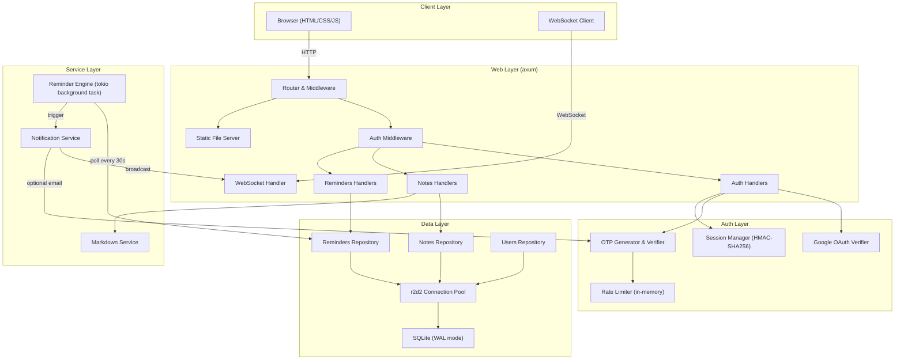
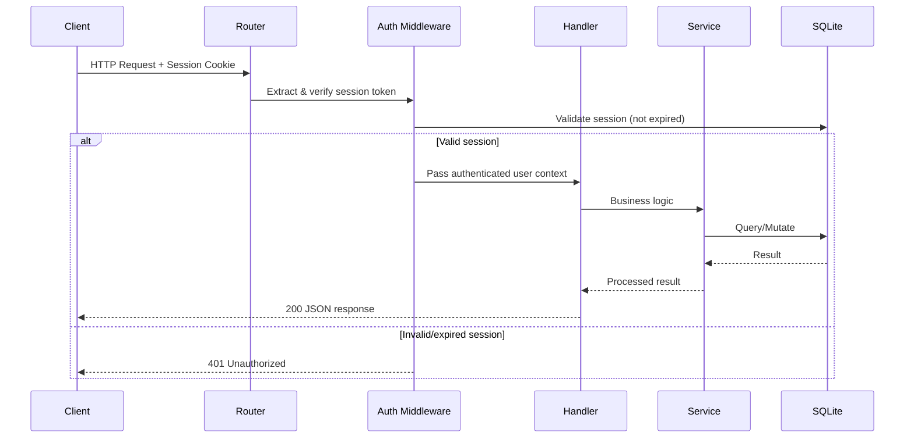
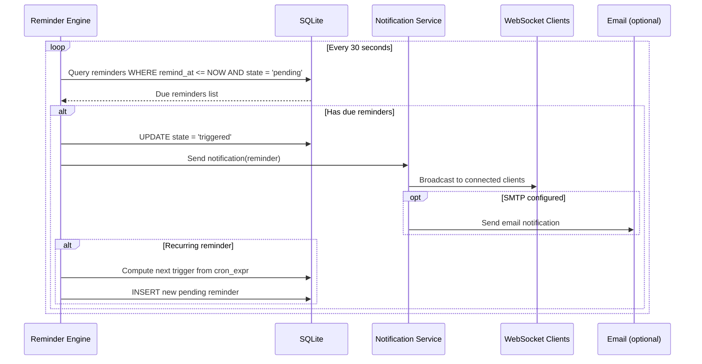
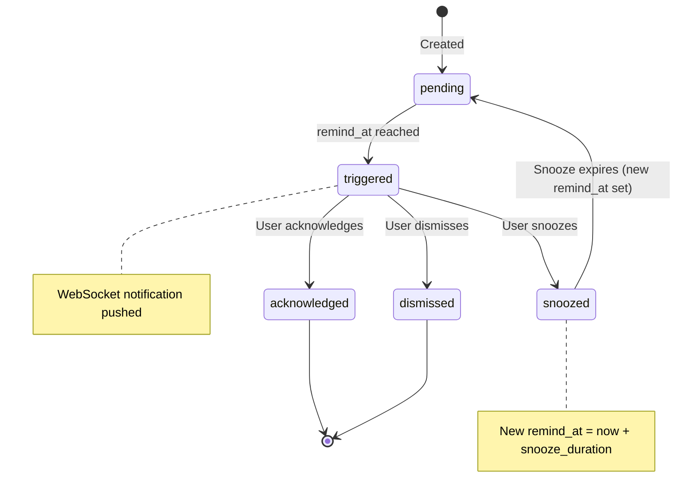
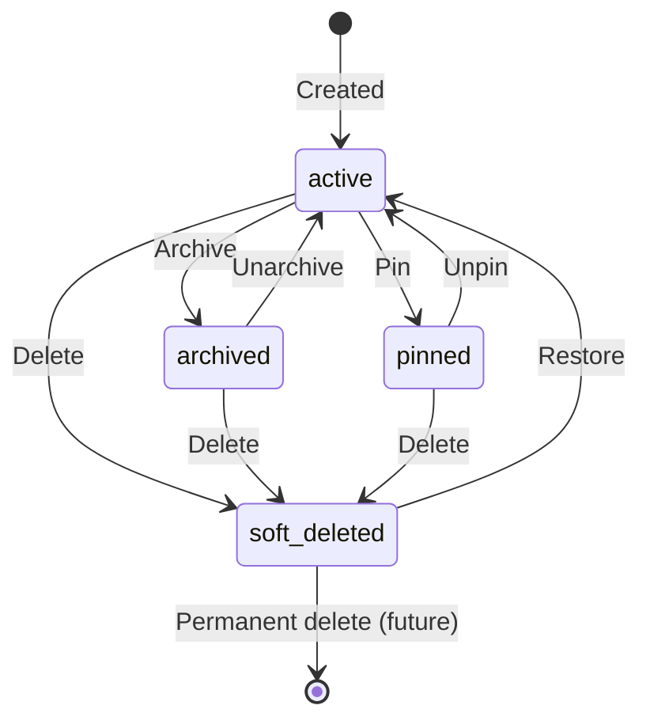

# evaNotes — Architecture Overview

---

## 1. Directory & Component Structure

```
evaNotes/
├── .github/workflows/
│   └── ci.yml                    # Test → Audit → Build → Docker Hub pipeline
├── docs/
│   ├── MASTER_PLAN.md            # Development phases & roadmap
│   ├── ARCHITECTURE.md           # This file
│   ├── DATABASE_SCHEMA.md        # Full schema documentation
│   ├── API_REFERENCE.md          # REST + WebSocket API docs
│   └── SECURITY_CHECKLIST.md     # Security audit checklist
├── migrations/
│   ├── V001__initial_schema.sql  # Users, notes, reminders tables
│   └── V002__add_indexes.sql     # Performance indexes
├── src/
│   ├── main.rs                   # Entry point, CLI args, server bootstrap
│   ├── config.rs                 # Environment config loader (.env + env vars)
│   ├── error.rs                  # Unified error types (AppError → HTTP responses)
│   ├── auth/
│   │   ├── mod.rs                # Auth module exports
│   │   ├── google.rs             # Google OAuth ID token verification
│   │   ├── otp.rs                # OTP generation, storage, verification, rate limiting
│   │   ├── session.rs            # HMAC-SHA256 session token create/verify
│   │   └── middleware.rs         # Axum auth extraction middleware
│   ├── db/
│   │   ├── mod.rs                # DB module exports & connection pool init
│   │   ├── migrations.rs         # Refinery migration runner
│   │   ├── notes.rs              # Notes CRUD repository
│   │   ├── reminders.rs          # Reminders CRUD repository
│   │   └── users.rs              # Users/sessions repository
│   ├── models/
│   │   ├── mod.rs                # Model exports
│   │   ├── note.rs               # Note struct (id, title, content, note_type, timestamps)
│   │   ├── reminder.rs           # Reminder struct (id, note_id, schedule, state, timestamps)
│   │   └── user.rs               # User struct (id, email, auth_method, created_at)
│   ├── handlers/
│   │   ├── mod.rs                # Handler exports & router assembly
│   │   ├── auth.rs               # Auth endpoints (Google, OTP, logout, status)
│   │   ├── notes.rs              # Notes CRUD endpoints
│   │   ├── reminders.rs          # Reminders CRUD + snooze/acknowledge endpoints
│   │   └── ws.rs                 # WebSocket handler for live notifications
│   ├── services/
│   │   ├── mod.rs                # Service exports
│   │   ├── markdown.rs           # Markdown → HTML rendering service
│   │   ├── reminder_engine.rs    # Background cron scheduler for recurring reminders
│   │   └── notification.rs       # WebSocket broadcast + optional email notification
│   └── web/
│       └── static/
│           ├── index.html        # SPA shell with tabs (Notes, Reminders, Settings)
│           ├── style.css         # Dark-mode design system, glassmorphism, animations
│           ├── app.js            # Frontend controller, API client, Markdown preview
│           └── assets/           # Icons, fonts
├── tests/
│   ├── common/mod.rs             # Shared test fixtures (test DB, mock server)
│   ├── test_auth.rs              # Auth flow integration tests
│   ├── test_notes.rs             # Notes CRUD integration tests
│   ├── test_reminders.rs         # Reminders CRUD + scheduling tests
│   └── test_security.rs          # Security-focused tests (injection, auth bypass, etc.)
├── Cargo.toml                    # Rust package manifest
├── Cargo.lock                    # Deterministic dependency lockfile
├── Dockerfile                    # Multi-stage build (builder + slim runtime)
├── docker-compose.yml            # Compose with volume mappings & env config
├── .dockerignore                 # Exclude target/, .git/, etc.
├── .env.example                  # Template environment variables
├── .gitignore                    # Rust/IDE/OS ignores
├── LICENSE                       # MIT License
├── README.md                     # User-facing documentation
└── AGENTS.md                     # AI/contributor architectural guide (gitignored)
```

---

## 2. Component Relationship Diagram



---

## 3. Request Flow

### Authenticated API Request



### Reminder Trigger Flow



---

## 4. State Machines

### Reminder State Machine



### Note Lifecycle



---

## 5. Key Architectural Decisions

### ADR-1: SQLite over PostgreSQL
- **Decision**: Use SQLite with WAL mode
- **Rationale**: Self-hosted, single-user app; no need for a separate database server; simplifies deployment; SQLite WAL supports concurrent reads while single-writer is fine for personal notes
- **Trade-off**: Not suitable for multi-user horizontal scaling (acceptable for self-hosted use case)

### ADR-2: axum over Actix-Web
- **Decision**: Use axum as the web framework
- **Rationale**: First-party tokio integration; tower middleware ecosystem; type-safe extractors; excellent error handling via `IntoResponse`; more active community momentum
- **Trade-off**: Slightly newer ecosystem, but well-supported by the tokio team

### ADR-3: Vanilla Frontend over WASM
- **Decision**: Vanilla HTML/CSS/JS frontend, no Rust WASM
- **Rationale**: Consistent with evaTorrent pattern; simpler build pipeline; no WASM compilation overhead; glassmorphism UI is CSS-heavy; Markdown preview via client-side library
- **Trade-off**: Less type safety on the frontend, but acceptable for a SPA of this complexity

### ADR-4: Background Polling over Cron Scheduler
- **Decision**: Tokio background task polling the DB every 30s for due reminders, rather than an in-memory cron scheduler per reminder
- **Rationale**: Survives server restarts; no state to reconstruct from DB; simpler implementation; 30s polling is acceptable latency for reminders
- **Trade-off**: Up to 30s delay on reminder triggers (configurable)

### ADR-5: Soft Delete for Notes
- **Decision**: Notes are soft-deleted (`is_deleted = 1, deleted_at = now()`) rather than hard-deleted
- **Rationale**: Data recovery; audit trail; consistent with evaTorrent's "never delete analytics" policy
- **Trade-off**: DB grows over time (mitigated by periodic hard-delete of old soft-deleted notes)
