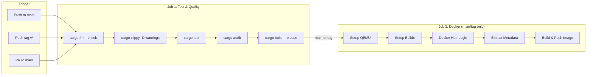

# evaNotes — CI/CD Pipeline

> GitHub Actions pipeline: Test → Lint → Audit → Build → Docker Hub Publish.

---

## 1. Pipeline Overview



---

## 2. Trigger Rules

| Event | Condition | Jobs Run |
|:---|:---|:---|
| `push` | Branch `main` | Test + Docker |
| `push` | Tag `v*` (e.g., `v0.1.0`) | Test + Docker |
| `pull_request` | Target `main` | Test only |

---

## 3. Job 1: Test & Quality Gates

| Step | Command | Gate Criteria |
|:---|:---|:---|
| **Checkout** | `actions/checkout@v7` | — |
| **Install Rust** | `dtolnay/rust-toolchain@stable` | Latest stable Rust |
| **Cache** | `Swatinem/rust-cache@v2` | Cache `target/` and registry |
| **Format Check** | `cargo fmt --check` | Zero formatting deviations |
| **Lint** | `cargo clippy -- -D warnings` | Zero warnings (treated as errors) |
| **Test** | `cargo test` | All tests pass |
| **Security Audit** | `cargo audit` | Zero known vulnerabilities |
| **Build** | `cargo build --release` | Successful compilation |
| **Upload Binary** | `actions/upload-artifact@v7` | Binary artifact preserved |

### Failure Policy
- **Any step failure** → entire job fails → PR cannot merge
- `cargo clippy` runs with `-D warnings` (deny all warnings)
- `cargo audit` must report zero vulnerabilities

---

## 4. Job 2: Docker Build & Push

**Runs only when**: Job 1 passes AND event is `push` to `main` or push of a `v*` tag.

| Step | Action | Details |
|:---|:---|:---|
| **Checkout** | `actions/checkout@v7` | — |
| **Setup QEMU** | `docker/setup-qemu-action@v4` | Multi-architecture support |
| **Setup Buildx** | `docker/setup-buildx-action@v4` | Advanced Docker builds |
| **Docker Hub Login** | `docker/login-action@v4` | Credentials from secrets |
| **Extract Metadata** | `docker/metadata-action@v6` | Auto-generate tags from Git |
| **Build & Push** | `docker/build-push-action@v7` | Multi-stage, cached |

### Docker Hub Secrets

| Secret | Description |
|:---|:---|
| `DOCKERHUB_USERNAME` | Docker Hub username (fallback: `akashkece`) |
| `DOCKERHUB_TOKEN` | Docker Hub access token (personal access token) |

### Tag Strategy

| Git Event | Docker Tags Generated |
|:---|:---|
| Push to `main` | `akashkece/evanotes:latest`, `akashkece/evanotes:sha-abc1234` |
| Push tag `v0.1.0` | `akashkece/evanotes:0.1.0`, `akashkece/evanotes:0.1`, `akashkece/evanotes:sha-abc1234` |
| Push tag `v1.0.0` | `akashkece/evanotes:1.0.0`, `akashkece/evanotes:1.0`, `akashkece/evanotes:sha-abc1234` |

---

## 5. Workflow File

```yaml
# .github/workflows/ci.yml

name: CI/CD Pipeline

on:
  push:
    branches: [ "main" ]
    tags: [ "v*" ]
  pull_request:
    branches: [ "main" ]

jobs:
  test:
    name: Test & Quality
    runs-on: ubuntu-latest
    steps:
      - name: Checkout Code
        uses: actions/checkout@v7

      - name: Install Rust Toolchain
        uses: dtolnay/rust-toolchain@stable
        with:
          components: rustfmt, clippy

      - name: Cache Cargo
        uses: Swatinem/rust-cache@v2

      - name: Format Check
        run: cargo fmt --check

      - name: Lint (Clippy)
        run: cargo clippy -- -D warnings

      - name: Run Tests
        run: cargo test

      - name: Security Audit
        run: |
          cargo install cargo-audit --locked
          cargo audit

      - name: Build Release Binary
        run: cargo build --release

      - name: Upload Binary Artifact
        uses: actions/upload-artifact@v7
        with:
          name: evanotes-binary
          path: target/release/evanotes

  docker:
    name: Build & Push Docker Image
    needs: test
    runs-on: ubuntu-latest
    if: github.event_name == 'push' && (github.ref == 'refs/heads/main' || startsWith(github.ref, 'refs/tags/v'))
    steps:
      - name: Checkout Code
        uses: actions/checkout@v7

      - name: Set up QEMU
        uses: docker/setup-qemu-action@v4

      - name: Set up Docker Buildx
        uses: docker/setup-buildx-action@v4

      - name: Log in to Docker Hub
        uses: docker/login-action@v4
        with:
          username: ${{ secrets.DOCKERHUB_USERNAME || 'akashkece' }}
          password: ${{ secrets.DOCKERHUB_TOKEN }}

      - name: Extract Docker Metadata
        id: meta
        uses: docker/metadata-action@v6
        with:
          images: akashkece/evanotes
          tags: |
            type=raw,value=latest,enable=${{ github.ref == 'refs/heads/main' }}
            type=semver,pattern={{version}}
            type=semver,pattern={{major}}.{{minor}}
            type=sha,prefix=sha-

      - name: Build and Push Docker Image
        uses: docker/build-push-action@v7
        with:
          context: .
          push: true
          tags: ${{ steps.meta.outputs.tags }}
          labels: ${{ steps.meta.outputs.labels }}
          cache-from: type=gha
          cache-to: type=gha,mode=max
```

---

## 6. Release Process

### Creating a Release

```bash
# 1. Ensure all phases are merged to main
git checkout main
git pull origin main

# 2. Verify everything passes locally
cargo fmt --check
cargo clippy -- -D warnings
cargo test
cargo audit

# 3. Tag the release
git tag v0.1.0
git push origin v0.1.0

# 4. GitHub Actions automatically:
#    - Runs full test suite
#    - Builds Docker image
#    - Pushes to Docker Hub as:
#      akashkece/evanotes:0.1.0
#      akashkece/evanotes:0.1
#      akashkece/evanotes:sha-<commit>

# 5. Verify on Docker Hub
docker pull akashkece/evanotes:0.1.0
docker run --rm -p 8080:8080 akashkece/evanotes:0.1.0
```

### Version Bumping Checklist

When creating a new version:

- [ ] Update version in `Cargo.toml`
- [ ] Update version in `docker-compose.yml` image tag
- [ ] Update version in `README.md` quickstart examples
- [ ] Verify no duplicate version strings (review `git diff`)
- [ ] Commit version bump: `git commit -m "chore: bump version to vX.Y.Z"`
- [ ] Create annotated tag: `git tag -a vX.Y.Z -m "Release vX.Y.Z"`
- [ ] Push: `git push origin main --tags`
