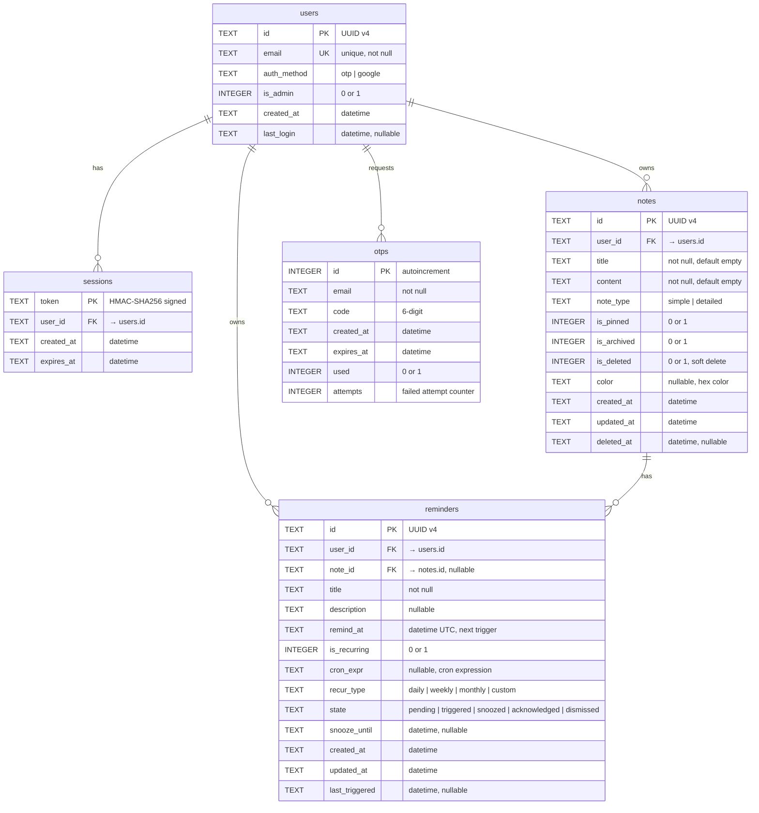

# evaNotes — Database Schema

> SQLite database with WAL mode, managed via `refinery` migrations.

---

## 1. Database Configuration

| Setting | Value | Rationale |
|:---|:---|:---|
| **Engine** | SQLite 3.x | Zero-config, file-based, embedded |
| **Journal Mode** | WAL (Write-Ahead Logging) | Concurrent reads during writes, crash safety |
| **Foreign Keys** | `PRAGMA foreign_keys = ON` | Enforced referential integrity |
| **Location** | `${EVA_DATA_DIR}/evanotes.db` | Configurable via environment |
| **Connection Pool** | `r2d2` (max 10 connections) | Thread-safe pooled access |
| **Migrations** | `refinery` (SQL files in `migrations/`) | Versioned, auto-applied on startup |

---

## 2. Entity-Relationship Diagram



---

## 3. Table Definitions

### 3.1 `users`

Stores registered user accounts. Single-admin model — only the email matching `ADMIN_EMAIL` can authenticate.

```sql
CREATE TABLE IF NOT EXISTS users (
    id          TEXT PRIMARY KEY,
    email       TEXT NOT NULL UNIQUE,
    auth_method TEXT NOT NULL DEFAULT 'otp',
    is_admin    INTEGER NOT NULL DEFAULT 0,
    created_at  TEXT NOT NULL DEFAULT (datetime('now')),
    last_login  TEXT
);
```

| Column | Type | Constraints | Description |
|:---|:---|:---|:---|
| `id` | TEXT | PRIMARY KEY | UUID v4 identifier |
| `email` | TEXT | NOT NULL, UNIQUE | User's email address |
| `auth_method` | TEXT | NOT NULL, DEFAULT 'otp' | Last auth method used: `'otp'` or `'google'` |
| `is_admin` | INTEGER | NOT NULL, DEFAULT 0 | Admin flag (1 = admin) |
| `created_at` | TEXT | NOT NULL, DEFAULT now | ISO 8601 creation timestamp |
| `last_login` | TEXT | nullable | ISO 8601 last login timestamp |

---

### 3.2 `sessions`

Active user sessions. Tokens are HMAC-SHA256 signed and stored in HTTP-only cookies.

```sql
CREATE TABLE IF NOT EXISTS sessions (
    token       TEXT PRIMARY KEY,
    user_id     TEXT NOT NULL REFERENCES users(id) ON DELETE CASCADE,
    created_at  TEXT NOT NULL DEFAULT (datetime('now')),
    expires_at  TEXT NOT NULL
);
```

| Column | Type | Constraints | Description |
|:---|:---|:---|:---|
| `token` | TEXT | PRIMARY KEY | HMAC-SHA256 signed session token |
| `user_id` | TEXT | FK → users(id), CASCADE | Owning user |
| `created_at` | TEXT | NOT NULL, DEFAULT now | Session creation time |
| `expires_at` | TEXT | NOT NULL | Session expiry (24h sliding window) |

---

### 3.3 `otps`

One-time password records for email-based authentication.

```sql
CREATE TABLE IF NOT EXISTS otps (
    id          INTEGER PRIMARY KEY AUTOINCREMENT,
    email       TEXT NOT NULL,
    code        TEXT NOT NULL,
    created_at  TEXT NOT NULL DEFAULT (datetime('now')),
    expires_at  TEXT NOT NULL,
    used        INTEGER NOT NULL DEFAULT 0,
    attempts    INTEGER NOT NULL DEFAULT 0
);
```

| Column | Type | Constraints | Description |
|:---|:---|:---|:---|
| `id` | INTEGER | PRIMARY KEY, AUTOINCREMENT | Unique OTP record ID |
| `email` | TEXT | NOT NULL | Target email address |
| `code` | TEXT | NOT NULL | 6-digit cryptographic OTP |
| `created_at` | TEXT | NOT NULL, DEFAULT now | OTP generation time |
| `expires_at` | TEXT | NOT NULL | OTP expiry (5 minutes) |
| `used` | INTEGER | NOT NULL, DEFAULT 0 | Whether the OTP has been consumed |
| `attempts` | INTEGER | NOT NULL, DEFAULT 0 | Failed verification attempts (max 5) |

---

### 3.4 `notes`

Core notes table supporting both simple (plain text) and detailed (Markdown) notes.

```sql
CREATE TABLE IF NOT EXISTS notes (
    id          TEXT PRIMARY KEY,
    user_id     TEXT NOT NULL REFERENCES users(id) ON DELETE CASCADE,
    title       TEXT NOT NULL DEFAULT '',
    content     TEXT NOT NULL DEFAULT '',
    note_type   TEXT NOT NULL DEFAULT 'simple',
    is_pinned   INTEGER NOT NULL DEFAULT 0,
    is_archived INTEGER NOT NULL DEFAULT 0,
    is_deleted  INTEGER NOT NULL DEFAULT 0,
    color       TEXT,
    created_at  TEXT NOT NULL DEFAULT (datetime('now')),
    updated_at  TEXT NOT NULL DEFAULT (datetime('now')),
    deleted_at  TEXT
);
```

| Column | Type | Constraints | Description |
|:---|:---|:---|:---|
| `id` | TEXT | PRIMARY KEY | UUID v4 identifier |
| `user_id` | TEXT | FK → users(id), CASCADE | Owning user |
| `title` | TEXT | NOT NULL, DEFAULT '' | Note title |
| `content` | TEXT | NOT NULL, DEFAULT '' | Note body (plain text or Markdown) |
| `note_type` | TEXT | NOT NULL, DEFAULT 'simple' | `'simple'` (text) or `'detailed'` (Markdown) |
| `is_pinned` | INTEGER | NOT NULL, DEFAULT 0 | Pin to top of list |
| `is_archived` | INTEGER | NOT NULL, DEFAULT 0 | Archived flag |
| `is_deleted` | INTEGER | NOT NULL, DEFAULT 0 | Soft-delete flag |
| `color` | TEXT | nullable | Optional color tag (hex code) |
| `created_at` | TEXT | NOT NULL, DEFAULT now | Creation timestamp |
| `updated_at` | TEXT | NOT NULL, DEFAULT now | Last update timestamp |
| `deleted_at` | TEXT | nullable | Soft-delete timestamp |

---

### 3.5 `reminders`

Reminders with support for one-time and recurring schedules, linkable to notes.

```sql
CREATE TABLE IF NOT EXISTS reminders (
    id            TEXT PRIMARY KEY,
    user_id       TEXT NOT NULL REFERENCES users(id) ON DELETE CASCADE,
    note_id       TEXT REFERENCES notes(id) ON DELETE SET NULL,
    title         TEXT NOT NULL,
    description   TEXT,
    remind_at     TEXT NOT NULL,
    is_recurring  INTEGER NOT NULL DEFAULT 0,
    cron_expr     TEXT,
    recur_type    TEXT,
    state         TEXT NOT NULL DEFAULT 'pending',
    snooze_until  TEXT,
    created_at    TEXT NOT NULL DEFAULT (datetime('now')),
    updated_at    TEXT NOT NULL DEFAULT (datetime('now')),
    last_triggered TEXT
);
```

| Column | Type | Constraints | Description |
|:---|:---|:---|:---|
| `id` | TEXT | PRIMARY KEY | UUID v4 identifier |
| `user_id` | TEXT | FK → users(id), CASCADE | Owning user |
| `note_id` | TEXT | FK → notes(id), SET NULL, nullable | Linked note (optional) |
| `title` | TEXT | NOT NULL | Reminder title |
| `description` | TEXT | nullable | Optional longer description |
| `remind_at` | TEXT | NOT NULL | Next trigger datetime (UTC ISO 8601) |
| `is_recurring` | INTEGER | NOT NULL, DEFAULT 0 | Recurring flag |
| `cron_expr` | TEXT | nullable | Cron expression (e.g., `0 9 * * 1` = every Monday 9am) |
| `recur_type` | TEXT | nullable | `'daily'`, `'weekly'`, `'monthly'`, `'custom'` |
| `state` | TEXT | NOT NULL, DEFAULT 'pending' | Current state in lifecycle |
| `snooze_until` | TEXT | nullable | Snooze expiry datetime |
| `created_at` | TEXT | NOT NULL, DEFAULT now | Creation timestamp |
| `updated_at` | TEXT | NOT NULL, DEFAULT now | Last update timestamp |
| `last_triggered` | TEXT | nullable | Last trigger datetime |

---

## 4. Indexes

```sql
-- Performance indexes for common query patterns

CREATE INDEX idx_notes_user_id ON notes(user_id);
CREATE INDEX idx_notes_deleted ON notes(is_deleted);
CREATE INDEX idx_notes_type ON notes(note_type);
CREATE INDEX idx_notes_updated ON notes(updated_at);

CREATE INDEX idx_reminders_user_id ON reminders(user_id);
CREATE INDEX idx_reminders_state ON reminders(state);
CREATE INDEX idx_reminders_remind_at ON reminders(remind_at);
CREATE INDEX idx_reminders_note_id ON reminders(note_id);

CREATE INDEX idx_sessions_user_id ON sessions(user_id);
CREATE INDEX idx_sessions_expires ON sessions(expires_at);

CREATE INDEX idx_otps_email ON otps(email);
CREATE INDEX idx_otps_expires ON otps(expires_at);
```

---

## 5. Migration Strategy

| File | Description |
|:---|:---|
| `migrations/V001__initial_schema.sql` | Create all tables (`users`, `sessions`, `otps`, `notes`, `reminders`) |
| `migrations/V002__add_indexes.sql` | Add all performance indexes |

### Rules
1. **Never modify existing migration files** — always create a new `V00N__description.sql`
2. Migrations run automatically on application startup via `refinery`
3. `refinery` tracks applied migrations in a `refinery_schema_history` table
4. All migrations must be **idempotent** (use `IF NOT EXISTS` / `IF EXISTS`)
5. Test migration rollback scenarios in `test_security.rs`
